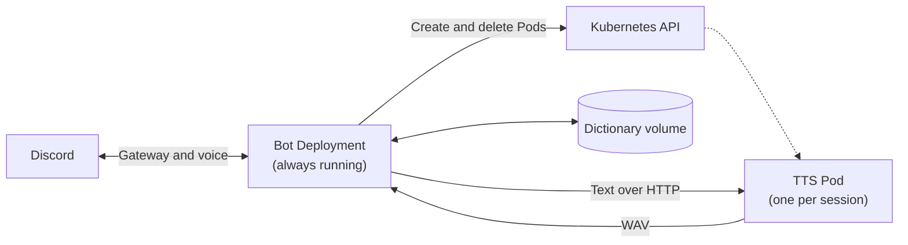
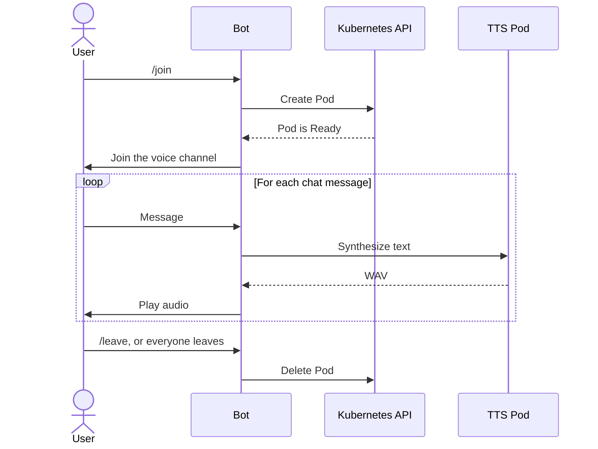

# discord-tts

A Discord bot that reads voice channel chat aloud in the voice channel. Only the bot runs all the time. It starts a text-to-speech (TTS) Pod on `/join` and deletes the Pod when the session ends, so idle sessions use no CPU or memory for speech synthesis.

## Architecture



The bot holds the voice connection, so TTS Pods never receive the bot token. A NetworkPolicy lets only the bot call a TTS Pod, and a TTS Pod cannot open any connections.



## Commands

| Command | Description |
|---|---|
| `/join [engine]` | Joins your voice channel and reads its chat. `engine` is `Open JTalk` or `VOICEVOX`. |
| `/leave` | Stops reading and leaves the voice channel. |
| `/voice <speaker>` | Changes the voice for the whole server (VOICEVOX only). It returns to the default after `/leave`. |
| `/dict add <word> <reading>` | Registers a word's reading, replacing any existing one. |
| `/dict del <word>` | Removes a word from the dictionary. |
| `/dict show` | Lists the dictionary. |

A session also ends, and its Pod is deleted, when the bot is disconnected or moved to another voice channel, or when everyone leaves the voice channel.

### Reading

- A message is read as `<server nickname>、<message>`.
- URLs, code blocks, and spoilers are read as placeholders, and custom emoji are removed.
- A message is cut off after 150 characters and ends with `以下略`.

### Dictionary

- Each server has its own dictionary, and any member can edit it.
- It applies to both messages and nicknames, and it ignores case.
- Longer words take priority, and a reading is never replaced again.
- The limits are 200 entries, 50 characters per word, and 100 characters per reading.

### Restart notices

The bot posts in the voice channel chat when:

- It recreates a TTS Pod after repeated synthesis failures.
- A TTS container restarts, for example after running out of memory. This check runs every 15 seconds.
- The bot itself shuts down or comes back after a crash.

## Speech engines

| Engine | Image | CPU and memory requests | CPU and memory limits | Notes |
|---|---|---|---|---|
| Open JTalk | Built from `openjtalk-server/` | 50m, 64Mi | 500m, 128Mi | Default. It has one voice. |
| VOICEVOX | `docker.io/voicevox/voicevox_engine:cpu-*` | 500m, 512Mi | 2, 3Gi | The reply to `/join` and `/voice` shows the required voice credit. |

VOICEVOX keeps each selected voice's model in memory until the session ends, at about 60 MB per character.

## Configuration

These are the bot's environment variables.

| Variable | Required | Default | Description |
|---|---|---|---|
| `DISCORD_TOKEN` | Yes | | Bot token. |
| `POD_NAMESPACE`, `POD_NAME`, `POD_UID` | Yes | | Set through the Downward API. They give TTS Pods their namespace and owner reference. |
| `OPENJTALK_IMAGE`, `VOICEVOX_IMAGE` | Yes | | TTS Pod images. |
| `DEFAULT_ENGINE` | | `openjtalk` | Engine used when `/join` has no `engine`. |
| `MAX_SESSIONS` | | `2` | Maximum number of concurrent sessions. |
| `VOICEVOX_SPEAKER` | | `3` | Default VOICEVOX style ID. `3` is Zundamon (Normal). |
| `ACTIVITY_NAME` | | None | Text for the bot's "Playing" status. If unset, no status is shown. |
| `DATA_DIR` | | `/data` | Dictionary location. Mount a persistent volume here. |

## Discord setup

1. Create a bot in the Developer Portal and enable **Message Content Intent**.
2. Invite it with the `bot` and `applications.commands` scopes and these permissions: View Channels, Send Messages, Connect, and Speak.

## Development

```sh
(cd openjtalk-server && go test ./...)
(cd bot && npm ci && npm run typecheck && npm test)
```

## Deployment

The manifests are in `manifest/cts/discord-tts/` of [dodolia907/k8s](https://github.com/dodolia907/k8s). Pushing a `v*` tag publishes the images to GHCR.
